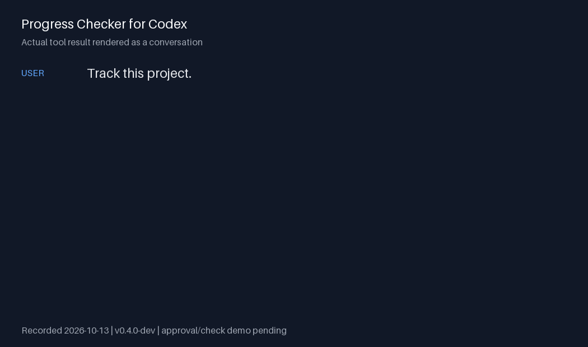

# Progress Checker for Codex

An agent can say “done” while tests are failing or its last test result is out of date. Progress Checker shows which project milestones have fresh passing checks, and which only have an implementation claim.

Try these three prompts after installing:

```text
Track this project.
Plan this feature with milestones and checks; show me the plan before saving it.
What’s the progress?
```



This demo shows an actual recorded tool result rendered as a conversation, not a screen recording. It demonstrates tracking and progress reporting; the complete human approval and passing-check demo is still pending. [Demo receipt](receipts/progress-demo.json).

## Install

1. Open `/plugins` in Codex and choose **Add marketplace**.
2. Enter `lwdot90/Progress-checker-for-Codex`.
3. Select **Progress Checker** and choose **Install**. Start a new chat if prompted.
4. Open your Git project and say **“Track this project.”**

The beta currently supports **Fedora 44 x86_64**. Installation was exercised with standard Codex 0.160.0 and 0.161.0. You need Python 3.11+, Git, glibc 2.39+, RPM and bubblewrap with working Linux namespaces. No Rust installation or source build is needed. Ubuntu, macOS and Windows are not yet supported. [Support and release details](release-status.md).

This repository is a custom Git marketplace: add it as a source to install the plugin.

## Use it on a feature

For a complete small project with a real check, try the [Python greeting example](../examples/first-check/README.md). For runtime restrictions and upcoming log privacy changes, see [commands and logs](COMMANDS_AND_LOGS.md).

Describe the outcome you want. Codex proposes milestones and the checks that would prove each outcome. Review and accept the plan before it saves it. An existing plan is preserved when you track a project.

As work proceeds, Codex records what it has implemented. Ask **“What’s the progress?”** to see which milestones have current passing checks. An implementation claim alone never marks a milestone verified. Editing source can make an earlier passing result out of date.

For example, “Implement the export endpoint” is a claim. “The endpoint acceptance test passes against these current files” is evidence. Progress Checker keeps those two statuses visible.

## Approve and run a check

Codex gives you an approval command for a specific check. Keep the chat open and run that command yourself in a separate interactive terminal. Review the displayed program, arguments, project and timeout, then confirm if you trust them. Return to the same chat and ask Codex to run the approved check.

You approve the **check definition**, not each execution. An unchanged check can be run again using that approval. Revising the saved plan invalidates approvals, so review the new definition when prompted. Installation and tracking never run project checks.

## How it complements CI

CI runs checks on submitted commits and pull requests. Keep using it. Progress Checker helps during the agent's work in your local checkout: it connects each agreed milestone to its acceptance check and flags results that no longer match the current source. It does not replace CI, code review or your judgment about whether the acceptance checks are sufficient.

## Update or remove

Use `/plugins` in the same Codex profile to update or remove the plugin. Start a new chat after an update if requested. **Remove** preserves your project plan and recorded check results.

If upgrading from an older archive installation, close its project Codex sessions and stop the old checker once before switching to the native plugin. Custom state locations need an explicit migration; [release details](release-status.md) describe this limit.

## Support

Report problems in the [GitHub issue tracker](https://github.com/lwdot90/Progress-checker-for-Codex/issues). Include your operating system, Codex version, plugin version and a redacted error. Avoid attaching credentials or private checker files.

For first-time testers: [first-user trial guide](TRY_IT.md).

For contributors: [development history](development-history.md), [Ubuntu portability assessment](PORTABILITY.md), and [release records](release-status.md).

Progress Checker is licensed under Apache-2.0. Codex is obtained separately. This project is maintained independently of OpenAI.
